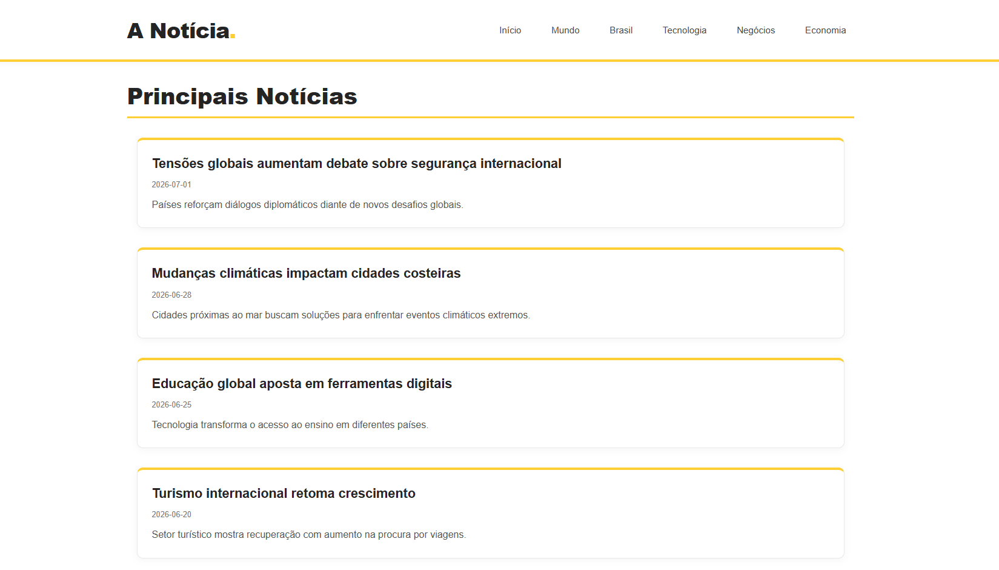

# 📰 A Notícia.

Um blog desenvolvido com **Next.js App Router** que exibe artigos organizados por categorias, utilizando rotas dinâmicas, renderização no servidor e boas práticas de SEO.

O projeto foi desenvolvido como exercício prático para consolidar conceitos avançados do **Next.js**, como Server Components, Data Fetching, rotas dinâmicas e geração de metadados para SEO. Também é um projeto para desenvolver habilidades com Pipelines CI/CD

---

## 🌎 Visualize online na Vercel

[Acessar o site](https://blog-inky-nine-91.vercel.app/)

---

## 🖥️ Prévia do projeto



---

## 💻 Acessando o Pipeline

O pipeline aparece na aba **Actions** deste repositório.

As etapas executadas pelo pipeline são:

- Build (verifica se o projeto pode ser compilado corretamente).
- Testes (executa o lint, verifica a formatação do código e executa os testes automatizados).
- Deploy(publica a aplicação na Vercel após todas as validações serem concluídas com sucesso).

Na aba Actions, é possível acompanhar a execução do pipeline e identificar se cada etapa foi concluída com sucesso. Caso alguma etapa falhe, o GitHub Actions apresenta os detalhes do erro para facilitar a identificação do problema.

---

## 🚀 Tecnologias Utilizadas

- Next.js (App Router)
- React
- TypeScript
- CSS Modules

---

## ✨ Funcionalidades

- 📰 Listagem de artigos na página inicial.
- 📂 Navegação por categorias.
- 🔗 Rotas dinâmicas para cada artigo.
- 📄 Carregamento de dados a partir de um arquivo JSON local.
- ⚡ Renderização utilizando Server Components.
- 🔍 SEO dinâmico com `generateMetadata`.
- 📱 Layout responsivo.

---

## 📚 Conceitos Praticados

- App Router
- Rotas Dinâmicas
- Server Components
- Data Fetching
- `generateStaticParams`
- `generateMetadata`
- SEO para aplicações Next.js
- Componentização
- CSS Modules
- Organização de projetos

---

## 📂 Estrutura do Projeto

```text
app/
├── artigos/
│   └── [slug]/
├── categoria/
│   └── [categoria]/
├── components/
├── data/
├── lib/
└── page.tsx
```

---

## ▶️ Como Executar

Clone o repositório:

```bash
git clone https://github.com/gabriellysaless/blog.git
```

Acesse a pasta do projeto:

```bash
cd blog
```

Instale as dependências:

```bash
npm install
```

Execute o projeto:

```bash
npm run dev
```

Depois, acesse:

```text
http://localhost:3000
```

---

## 🎯 Objetivo

Este projeto teve como objetivo colocar em prática os principais recursos do **Next.js App Router**, desenvolvendo um blog com conteúdo dinâmico, organização por categorias e páginas otimizadas para mecanismos de busca.

Além dos conceitos do framework, o projeto também reforça boas práticas de organização de componentes, separação de responsabilidades e estruturação de aplicações modernas em React.

---

## 👩‍💻 Desenvolvido por

**Gabrielly Oliveira Sales Almeida**

- GitHub: https://github.com/gabriellysaless
